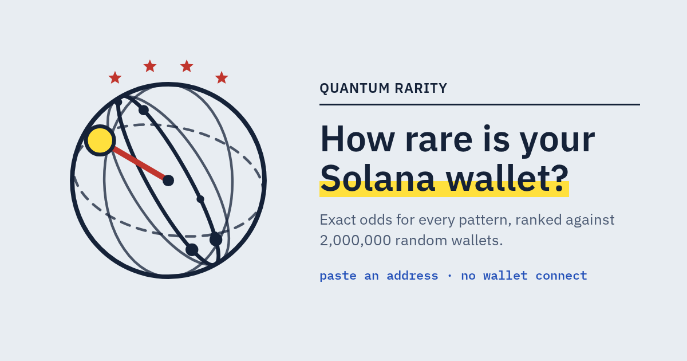
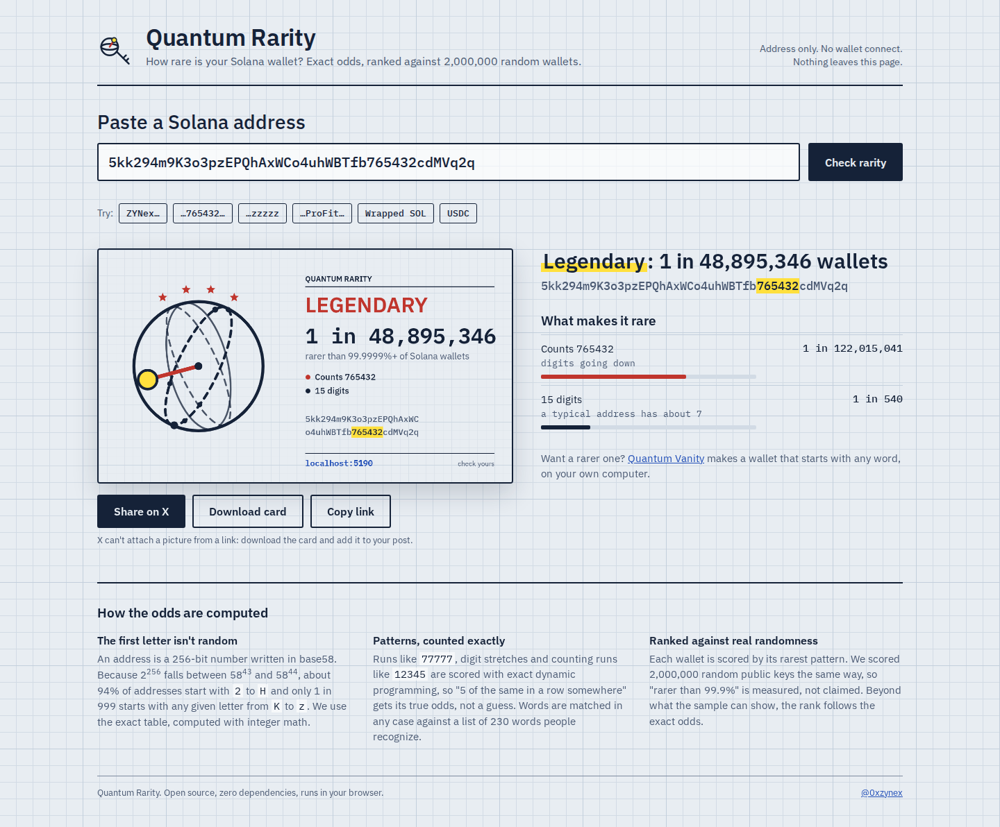
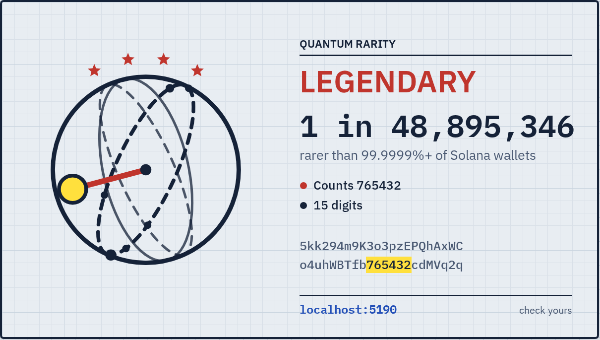

<p align="center"></p>

<p align="center">
  
  
  
  
  
</p>

# Quantum Rarity

**How rare is your Solana wallet?** Paste any address and get the exact odds of every pattern in it, a sigil drawn from its bytes, and a card to share. Ranked against 2,000,000 random wallets.

The sister project of [Quantum Vanity](https://github.com/0xzynex/quantum-vanity): Vanity *makes* a rare wallet, Rarity *measures* any wallet.

<p align="center"></p>

## What it finds

| Pattern | Example | Odds for a random wallet |
|---|---|---|
| Same character at the start | `5555…` | 1 in 195,875 for 4 |
| Same character at the end | `…zzzzz` | 1 in 11.3M for 5 |
| A run anywhere | `…WWWWW…` | exact DP over the whole address |
| Counting digits | `…765432…` | 1 in 122M for 6 |
| A real word, any case | `…ProFit…` | summed over the whole word list |
| Leading zero bytes | `11…` | 1 in 65,536 |
| Mirrored or repeated ends | `DwD…DwD` | 1 in 58ⁿ |
| No numbers at all, or far too many | 22 digits | exact binomial tail |
| A rare first letter | `K` … `z` | 1 in 25 |

Every number comes from first principles. The first character uses the exact table computed with BigInt (about 94% of addresses start with `2` to `H`), runs and digit stretches use exact dynamic programming, and the test suite checks the odds against 300,000 random keys and 20,000 real ed25519 keys.

## The score

A wallet's score is the rarity of its rarest pattern. We scored 2,000,000 random public keys the same way (`npm run calibrate`), so **"rarer than 99.9%" is measured, not claimed**. Past what the sample can resolve, the rank follows the exact odds with a fitted constant (`data/calibration.json`). 89% of addresses have no rare pattern at all.

| Tier | Rarer than |
|---|---|
| Common | — |
| Uncommon | 1 in 10 |
| Rare | 1 in 100 |
| Epic | 1 in 10,000 |
| Legendary | 1 in 1,000,000 |
| Mythic | 1 in 100,000,000 |

<p align="center"></p>

## Safety

- **Address only.** No wallet connect, no signatures. All the math runs in the page.
- **Simple stats.** The server counts page views and which public addresses get checked (a random id per browser, no IPs, no keys). The owner sees them at `/stats?key=…`; `deploy.sh` prints the link.
- If someone pastes a **private key, keypair file or seed phrase**, the page refuses it, clears the box and warns them.
- A strict Content Security Policy: scripts only from the site itself.

## Run it locally

```
npm start          # http://localhost:5190
npm test           # 7 tests: math vs brute force, vs random keys, vs real ed25519 keys
```

## Put it on a VPS with your domain

1. Buy the domain (Namecheap, Porkbun…) and a small VPS with Ubuntu (any $5 plan works: it's a static site).
2. In your domain's DNS settings add two **A records** pointing at the VPS IP: `@` and `www`.
3. On the VPS:
   ```
   git clone https://github.com/0xzynex/quantum-rarity.git
   cd quantum-rarity
   sudo bash deploy/deploy.sh yourdomain.xyz
   ```
   Behind Cloudflare with the orange cloud: `sudo bash deploy/deploy.sh yourdomain.xyz cloudflare` and SSL mode **Full**.
4. Open `https://yourdomain.xyz`. Caddy gets the HTTPS certificate on its own.

To update later: `git pull && sudo bash deploy/deploy.sh yourdomain.xyz`.

## Files

```
index.html            the page
web/app.js            UI, share card, Share on X
src/rarity.js         traits, exact odds, ranking
src/sigil.js          the Bloch-sphere sigil drawn from the 32 key bytes
src/words.js          words matched in any case
data/calibration.json rank table from 2,000,000 random keys
deploy/               Caddyfile + one-command VPS deploy
```

## License

MIT. Fonts: IBM Plex, SIL Open Font License (`assets/fonts/OFL.txt`).
